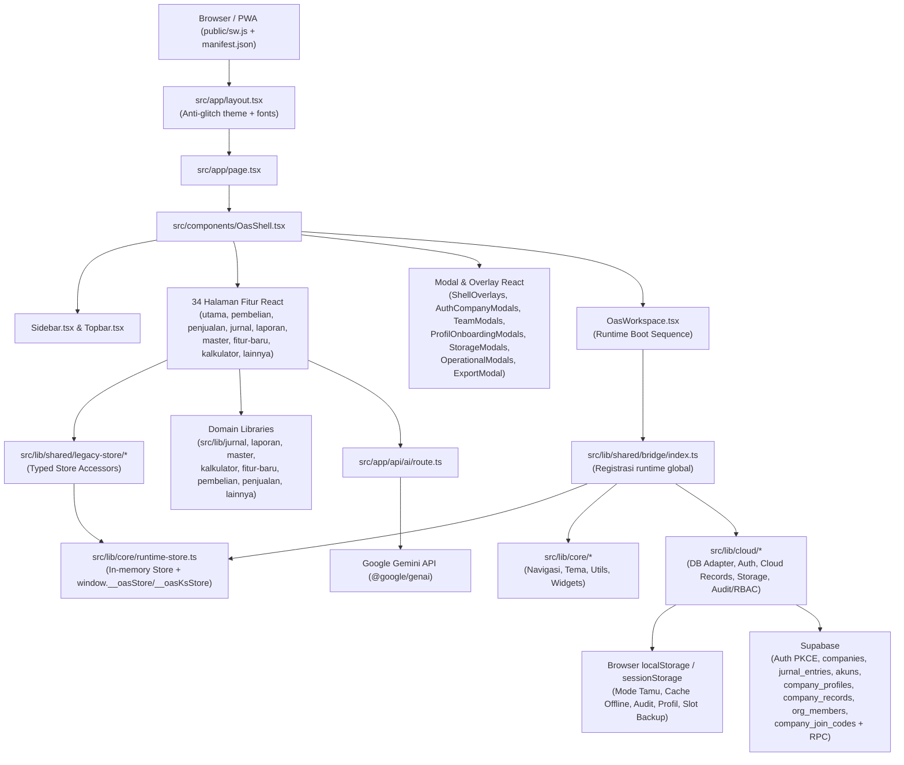

# Arsitektur OAS (Orias Accounting System)

Dokumen ini memetakan arsitektur aplikasi **OAS** pada kondisi terkini setelah migrasi penuh ke **Next.js 16 (App Router) + React 19 + TypeScript** (tanpa lagi skrip `public/js/*` maupun template HTML di `src/templates/`).

---

## 1. Gambaran Umum & Alur Data

### Urutan Boot Aplikasi (`OasWorkspace.tsx`)
1. `registerOasCoreBridge()` — inisialisasi `runtime-store.ts` (`window.__oasStore` & `window.__oasKsStore`) dan mendaftarkan seluruh fungsi lintas-modul (core, cloud, fitur-baru, kalkulator, export, admin/auth).
2. Inisialisasi lifecycle UI: `initNavigationLifecycle()` (tema, hash URL, `popstate`), `initInfoPopoverHover()`, `initCurrentDateLabel()`, `initGlobalShortcuts()` (`Ctrl+K`, `Ctrl+S`, `Ctrl+N`), `initPullToRefresh()`, `initMobileKeyboardScrollFix()`, `setupNumberInputs()`.
3. Memuat SDK `@supabase/supabase-js@2` (fallback ke offline stub bila tanpa jaringan), lalu menjalankan `initDbAdapter()`.
4. `logStartupAudit()` + masuk mode cloud (`initStorageLight()` + `initSupabase()`) atau mode demo lokal (`initLocalStorageFull()`), lalu mengecek parameter undangan `?join=CODE` (`checkJoinCodeInURL()`).
5. Registrasi Service Worker `/sw.js` (khusus produksi, di-unregister otomatis pada host dev preview).

---

## 2. Peta Penyimpanan Data

### A. Supabase (Cloud Multi-User & Multi-Bisnis)
| Tabel / RPC | Isi Data | Dikelola Oleh |
| :--- | :--- | :--- |
| `companies` | Daftar bisnis (`id`, `user_id`, `name`, `type`, `created_at`) | `src/lib/cloud/supabase-data.ts` |
| `jurnal_entries` | Entri jurnal umum (`no`, `tanggal`, `ket`, `jenis`, `lines`, `attachments`, `meta`) | `src/lib/cloud/supabase-data.ts` |
| `akuns` | Chart of Accounts per bisnis (`kode`, `nama`, `tipe`, `kat`, `normal`) | `src/lib/cloud/supabase-data.ts` |
| `company_profiles` | JSON profil perusahaan (`_profil`), kunci periode (`_periode_kunci`), dan multi kartu stock (`_multi_kartu_stock`) | `src/lib/cloud/supabase-data.ts` |
| `company_records` | Penyimpanan generik bertipe `kind` + `rid` untuk `invoice`, `bill`, `pembayaran`, `dok`, `counter`, `kontak`, `aset_tetap`, `produk`, `jurnal_berulang`, `anggaran`, `alert`, `kurs` | `src/lib/cloud/cloud-records.ts` |
| `org_members` | Anggota tim, peran (`admin`/`member`/`viewer`), izin akses per modul, status | `src/lib/cloud/audit-permission.ts`, `TeamModals.tsx` |
| `company_join_codes` | Kode undangan 8 karakter (masa berlaku 7 hari) | `src/lib/cloud/audit-permission.ts`, `TeamModals.tsx` |
| RPC `klaim_undangan`, `buat_kode_gabung`, `gabung` | Aktivasi undangan email, pembuatan kode gabung aman, dan proses bergabung ke bisnis | `supabase-data.ts`, `audit-permission.ts` |

### B. Browser Storage (`localStorage` / `sessionStorage`)
| Key | Isi Data | Pengelola |
| :--- | :--- | :--- |
| `oas_data_v2_<cid\|guest>`, `oas_meta_v2_<cid\|guest>` | Snapshot data lokal (jurnal, COA, trash, mapping transaksi, kunci periode, produk) | `src/lib/cloud/local-storage.ts` |
| `oas_slots_v2`, `oas_autosave_enabled` | 5 slot simpan manual & preferensi auto-save | `src/lib/cloud/local-storage.ts` |
| `oas_rec_cache_<cid>_<kind>` | Cache offline per `kind` dari `company_records` | `src/lib/cloud/cloud-records.ts` |
| `oas_companies_<uid>`, `oas_active_company_<uid>` | Cache daftar bisnis & bisnis terakhir yang dibuka per user | `src/lib/cloud/supabase-data.ts` |
| `oas_oas_auth` | Sesi autentikasi Supabase PKCE | `src/lib/cloud/db-adapter.ts` |
| `oas_profil_v1`, `oas_company_logo`, `oas_onboarded` | Profil bisnis aktif, logo perusahaan (DataURL), status onboarding | `src/lib/cloud/profil.ts` |
| `oas_profile_photo`, `oas_saved_accounts` | Foto profil user & daftar riwayat akun pada Account Switcher | `ui-widgets.ts`, `settings-switcher.ts` |
| `oas_audit_trail` | Log aktivitas lokal hingga 2000 entri | `src/lib/cloud/audit-permission.ts` |
| `oas_theme` | Preferensi tema (`dark` / `light`) | `layout.tsx`, `navigation-theme.ts` |
| `oas_mks_<cid\|guest>` | Cache multi kartu stock (gudang, rak, barang, layer FIFO/LIFO/WA/MWA) | `supabase-data.ts`, `kartu-stock/storage.ts` |
| `oas_pesanan_pembelian_<cid>`, `oas_pesanan_penjualan_<cid>`, `oas_pengiriman_<cid>` | Data PO Pembelian, SO Penjualan, dan daftar ekspedisi per bisnis | `pesanan-pembelian.ts`, `pesanan-penjualan.ts`, `pengiriman.ts` |
| `oas_invoices`, `oas_bill`, `oas_pembayaran`, `oas_dok`, `oas_counter`, `oas_kontak`, `oas_aset_tetap`, `oas_jb`, `oas_jb_hist`, `oas_anggaran`, `oas_alerts`, `oas_notif_hist`, `oas_kurs`, `oas_attachments_v1` | Penyimpanan lokal fitur operasional & lampiran jurnal | `runtime-store.ts`, `fitur-tambahan.ts`, `store-*.ts` |
| `sessionStorage: oas_pending_join` | Kode `?join=` tertunda sebelum user menyelesaikan login | `audit-permission.ts`, `supabase-data.ts` |

---

## 3. Peta Lengkap File & Keterhubungan

### A. Root, Konfigurasi, Dokumentasi & Publik

| File | Memproses / Menyimpan | Terhubung Dengan |
| :--- | :--- | :--- |
| `package.json`, `package-lock.json` | Daftar dependensi (`next`, `react`, `@google/genai`, `jspdf`, `jspdf-autotable`, `xlsx`, `lucide-react`, `motion`) dan skrip `dev`/`build`/`start`/`lint`. | Seluruh `src/` |
| `next.config.ts` | Konfigurasi Next.js (`output: "standalone"`, `allowedDevOrigins`). | Build & server Next.js |
| `tsconfig.json`, `next-env.d.ts` | Konfigurasi TypeScript dan path alias `@/* -> src/*`. | Seluruh file `.ts` / `.tsx` |
| `.env.example`, `.gitignore`, `metadata.json` | Contoh env (`GEMINI_API_KEY`, Supabase), aturan git, metadata proyek. | `src/app/api/ai/route.ts`, `db-adapter.ts` |
| `AGENTS.md`, `Roadmap.md` | Aturan agent Next.js & catatan roadmap pengembangan. | Dokumentasi pengembang |
| `docs/README.md`, `docs/FILE_MAP.md`, `docs/SCHEMA.md`, `docs/DESAIN_AKSES_TIM.md` | Dokumentasi desain sistem, skema DB, dan desain kontrol akses tim. | `src/lib/cloud/*`, `docs/migrations/*` |
| `docs/migrations/003_akses_tim_data.sql` & `.test.sql` | Migrasi SQL RLS, `org_members`, `company_join_codes`, RPC `gabung`/`buat_kode_gabung`/`klaim_undangan`, serta skrip uji SQL. | Supabase DB, `audit-permission.ts`, `supabase-data.ts` |
| `public/manifest.json` | Manifest PWA (ikon, warna tema, shortcuts ke `#transaksi`, `#dashboard`, `#jurnal-umum`). | `src/app/layout.tsx`, `public/icon-*.png` |
| `public/sw.js` | Service Worker PWA (network-first aset inti, bypass `/_next/` & localhost, fallback offline). | `OasWorkspace.tsx`, `manifest.json` |
| `public/icon-192.png`, `public/icon-512.png` | Ikon aplikasi PWA. | `manifest.json` |

---

### B. App Router & Styling (`src/app/`, `src/styles/`, `src/config/`, `src/types/`)

| File | Memproses / Menyimpan | Terhubung Dengan |
| :--- | :--- | :--- |
| `src/app/layout.tsx` | Root HTML layout, metadata SEO/PWA, Google Fonts, dan inline `ANTI_GLITCH_SCRIPT` untuk menerapkan `oas_theme` sebelum hidrasi. | `globals.css`, `page.tsx`, `manifest.json` |
| `src/app/page.tsx` | Entry halaman utama (`force-static`), langsung me-render `<OasShell />`. | `src/components/OasShell.tsx` |
| `src/app/globals.css` | Mengimpor semua stylesheet `src/styles/*` serta aturan tambahan date/month input, `.kalk-grid`, `.modal-body`, `.rasio-row`, dan animasi halaman. | `layout.tsx`, `src/styles/*.css` |
| `src/app/api/ai/route.ts` | API Route `POST /api/ai` (runtime Node.js): validasi request, memanggil Google Gemini API lewat `@google/genai` dengan retry otomatis untuk error sementara. | `src/lib/lainnya/orias-ai/*`, `AiAssistantPage.tsx` |
| `src/styles/theme.css` | Token warna tema Gelap & Terang (`--bg`, `--surface`, `--accent`, dll.) dan tipografi. | `globals.css`, `navigation-theme.ts` |
| `src/styles/layout.css` | Layout utama: sidebar, topbar, konten halaman, responsive container. | `Sidebar.tsx`, `Topbar.tsx`, `OasShell.tsx` |
| `src/styles/components.css` | Komponen UI bersama: kartu, tabel, tombol, modal, badge, picker, spinner, cropper, auth screen, company picker. | Seluruh `src/components/**` |
| `src/styles/pages.css` | Styling spesifik halaman (Dashboard, Analitik, Jurnal, Audit Trail, Kartu Stock, Pajak, Settings). | Halaman fitur di `src/components/**` |
| `src/styles/icons.css` | Definisi kelas ikon Tabler (`.ti`, `.ti-*`). | Seluruh komponen UI |
| `src/styles/mobile-responsive.css` | Penyesuaian breakpoint layar kecil / perangkat mobile. | `globals.css` |
| `src/config/navigation.ts` | Definisi terpusat menu navigasi Sidebar (grup, label, ikon, target halaman/aksi global, badge). | `Sidebar.tsx` |
| `src/types/index.ts` | Barrel export seluruh tipe domain. | Seluruh `src/` |
| `src/types/accounting.ts` | Tipe inti akuntansi (`Akun`, `AkunTipe`, `AkunTrashItem`, `JurnalEntry`, `JurnalLine`, `SaldoMap`, `TahunBukuRange`, `TransaksiAkunSettings`, dll.). | `src/lib/**`, `src/components/**` |
| `src/types/billing.ts` | Tipe penagihan (`Invoice`, `Bill`, `Pembayaran`, `DokRecord`, `CounterRecord`, item & status). | `InvoicePage`, `pembayaran/*`, `penomoran-invoice.ts` |
| `src/types/master.ts` | Tipe data master (`Produk`, `Kontak`, `AsetTetap`). | `CoaPage`, `KontakPage`, `AsetTetapPage`, `store-master.ts` |
| `src/types/calculator.ts` | Tipe input/hasil kalkulator keuangan & kartu stock persediaan. | `src/lib/kalkulator/**`, `src/components/kalkulator/**` |
| `src/types/company.ts` | Tipe perusahaan/profil & pengaturan bisnis. | `src/lib/cloud/**` |
| `src/types/navigation.ts` | Tipe struktur menu & aksi sidebar. | `src/config/navigation.ts`, `Sidebar.tsx` |

---

### C. Core Runtime & Cloud Layer (`src/lib/core/`, `src/lib/cloud/`, `src/lib/shared/`)

| File | Memproses / Menyimpan | Terhubung Dengan |
| :--- | :--- | :--- |
| `src/lib/core/runtime-store.ts` | State store utama in-memory (COA, jurnal, counter, kunci periode, produk, kontak, aset, invoice, bill, pembayaran, dok, kartu stock, user/company aktif); mengekspos `window.__oasStore`, `window.__oasKsStore`, `seedData()`, `resolveAkunSettingRuntime()`. | `bridge/index.ts`, `legacy-store/*`, `cloud/*` |
| `src/lib/core/runtime-utils.ts` | Wrapper stateful atas utilitas akuntansi & format (saldo, PPN, kunci periode `guardPeriode`, tahun buku, AI parser) + info popover `.info-icon-btn`. | `shared/accounting`, `shared/format`, `bridge/index.ts` |
| `src/lib/core/navigation-theme.ts` | Routing berbasis halaman (`showPage`), guard izin modul, history `pushState`/`popstate`, `toggleSidebar`/`closeSidebar`, manajemen tema (`initTheme`, `applyTheme`, `toggleTheme`, PWA chrome). | `audit-permission.ts`, `akses-bisnis.ts`, `Sidebar.tsx`, `Topbar.tsx`, `OasWorkspace.tsx` |
| `src/lib/core/ui-widgets.ts` | Toast `showAlert`, morph sukses `showSuccessMorph`, `showOpSpinner`/`hideOpSpinner`, dialog Promise (`showCustomConfirmGeneral`, `showCustomInputModal`, `showCustomSelectModal`), format angka input, shortcut keyboard global, pull-to-refresh, delegasi overlay ke `ShellOverlays`. | `ShellOverlays.tsx`, `bridge/index.ts`, seluruh halaman & modul cloud |
| `src/lib/core/index.ts` | Barrel export seluruh modul `src/lib/core/*`. | `bridge/index.ts`, `OasWorkspace.tsx` |
| `src/lib/cloud/db-adapter.ts` | Inisialisasi klien Supabase (`initDbAdapter`, `getDB`, `getSupa`), storage auth PKCE fallback (`localStorage` → `sessionStorage` → memory), serta konfigurasi `SUPABASE_URL`/`SUPABASE_ANON_KEY`. | `OasWorkspace.tsx`, `supabase-data.ts`, `cloud-records.ts`, `audit-permission.ts` |
| `src/lib/cloud/supabase-data.ts` | Alur auth penuh (`initSupabase`, OAuth PKCE exchange, `onAuthStateChange`, Mode Tamu, `afterLogin`, `doLogout`), manajemen daftar & perpindahan bisnis (`getMyCompanies`, `selectCompany`, `createCompanyRecord`, `deleteCompanyRecord`), CRUD cloud (`jurnal_entries`, `akuns`, `company_profiles`, lampiran, kartu stock), dan hook inti `saveToStorage`, `manualSave`, `addJurnal`, `postJurnalLegacy`. | `db-adapter.ts`, `cloud-records.ts`, `local-storage.ts`, `audit-permission.ts`, `AuthCompanyModals.tsx` |
| `src/lib/cloud/cloud-records.ts` | Sinkronisasi berbasis diff untuk 12 `kind` pada tabel `company_records` (`cloudLoadRecords`, `cloudSyncRecords`, `cloudDeleteRecords`, cache offline, migrasi lokal ke cloud). | `db-adapter.ts`, `supabase-data.ts`, `local-storage.ts`, `legacy-store/*` |
| `src/lib/cloud/local-storage.ts` | Serialisasi & persistensi lokal (`saveToLocalStorage`, `loadFromStorage`), auto-save terjadwal, 5 slot penyimpanan, export/import backup `.oas`/`.json`, serta eksekusi reset data selektif lokal & cloud. | `StorageModals.tsx`, `supabase-data.ts`, `cloud-records.ts`, `fitur-tambahan.ts` |
| `src/lib/cloud/profil.ts` | Baca/tulis profil perusahaan (`oas_profil_v1`), logo perusahaan (`oas_company_logo`), registry modal React (`registerReactModal`, `openModal`, `closeModalReactAware`), `handleLogoUpload`, banner mode demo, dan perbaikan scroll keyboard mobile. | `ProfilOnboardingModals.tsx`, `TeamModals.tsx`, `StorageModals.tsx`, `bridge/index.ts` |
| `src/lib/cloud/audit-permission.ts` | Logger audit trail (`auditLog`, `auditGetAll`, export CSV, pembersihan >90 hari, login/logout), RBAC (`loadOrgMembers`, `isAdmin`, `isReadOnly`, `guardHanyaBaca`, `hasPerm`, `enforcePermissions`), dan manajemen Join Code (`getOrCreateJoinCode`, `checkJoinCodeInURL`, `processJoinCode`). | `TeamModals.tsx`, `AuditTrailPage.tsx`, `supabase-data.ts`, `navigation-theme.ts`, `akses-bisnis.ts` |
| `src/lib/cloud/index.ts` | Barrel export seluruh modul `src/lib/cloud/*`. | `bridge/index.ts`, `OasWorkspace.tsx` |
| `src/lib/shared/bridge/index.ts` | Titik registrasi tunggal (`registerOasCoreBridge`) yang memasang `OAS_PURE_LIB` dan seluruh fungsi lintas-modul ke `window` agar semua komponen/modul tetap terhubung konsisten. | `OasWorkspace.tsx`, seluruh domain `src/lib/*` |
| `src/lib/shared/legacy-store/types.ts` | Kontrak tipe `OasLegacyStoreBridge`, `OasKsStoreBridge`, `DbAdapterLike`, `CompanyLike`, `SupabaseUserLike`, dan tipe record fitur. | `store-*.ts`, `runtime-store.ts`, `cloud/*` |
| `src/lib/shared/legacy-store/store-inti.ts` | Accessor typed (`getWin`, `callOasGlobal`, `setOasWindowFn`, `getCloudSync`, read/write `akuns`, `jurnalEntries`, `currentCompany`, `currentUser`, `periodeKunciSampai`, `jurnalCounter`, `transaksiAkunSettings`, `dbAdapter`). | Seluruh `src/components/**` & `src/lib/**` |
| `src/lib/shared/legacy-store/store-master.ts` | Accessor typed untuk `multiKartuStock`, `kartuStockData`, `produkList`, `kontakList` (+ `simpanKontakState`), dan `asetTetapList`. | `CoaPage`, `KontakPage`, `AsetTetapPage`, `kalkulator/persediaan/*`, `supabase-data.ts` |
| `src/lib/shared/legacy-store/store-tagihan.ts` | Accessor typed untuk `invoiceList`, `billList`, `pembayaranList`, `dokList`, `anggaranList`, `notifAlerts`, `notifHistory`, `jurnalBerulangList`, `kursData`, beserta helper simpan/hapus pembayaran. | `InvoicePage`, `pembayaran/*`, `fitur-baru/*`, `cloud-records.ts` |
| `src/lib/shared/legacy-store/index.ts` | Barrel export `legacy-store/*`. | Seluruh `src/` |
| `src/lib/shared/accounting/saldo-periode.ts` | Konstanta `JENIS_JURNAL`/`SUMBER_JURNAL`, `PeriodeTerkunciError`, `isPeriodeTerkunci`, rentang tahun buku, perhitungan saldo alami & bersih (`computeSaldoAll`, `computeSaldoBersih`, `plNatural`, `saldoAlamiPL`). | `runtime-utils.ts`, `laporan/*`, `dashboard/*`, `fitur-tambahan.ts` |
| `src/lib/shared/accounting/jurnal-helper.ts` | Helper jurnal pembalik (`getReversalOf`, `getReversedMap`, `isJurnalDibalik`), filter jurnal pembelian aktif, `resolveAkunSetting`, `getAkunNama`, `parseJurnalFromAI`. | `runtime-utils.ts`, `jurnal/*`, `TransaksiPage.tsx`, `SettingsPage.tsx` |
| `src/lib/shared/accounting/ppn-rekap.ts` | Perhitungan PPN (`hitungPpn`, `akunPpnKeluaranKode`, `ppnDariJurnal`, `rekapPpnJurnal`). | `PajakPage.tsx`, `DashboardPage.tsx`, `export/*` |
| `src/lib/shared/accounting/index.ts` | Barrel export `accounting/*`. | `shared/index.ts`, `core/*` |
| `src/lib/shared/format/index.ts` | Helper format murni (`fmtRp`, `fmtDate`, `rpNum`, `ymd`, `escapeHtml`, `escapeForJsAttr`). | Seluruh `src/lib/**` & `src/components/**` |
| `src/lib/shared/penomoran/index.ts` | Logika murni penomoran berurut (`parseNomor`, `nomorBerikut`, `counterSetelahPakai`, resolusi bentrok nomor). | `penomoran-invoice.ts`, `bridge/index.ts` |
| `src/lib/shared/index.ts`, `src/lib/index.ts` | Barrel export tingkat shared dan root `src/lib/`. | Pemanggil modul library |

---

### D. Domain Libraries (`src/lib/<domain>/`)

| File | Memproses / Menyimpan | Terhubung Dengan |
| :--- | :--- | :--- |
| `src/lib/utama/dashboard/index.ts` & `src/lib/utama/index.ts` | Agregasi KPI Dashboard (aset, pendapatan, beban, laba bersih, tren bulanan, piutang/hutang, pengingat penyesuaian). | `DashboardPage.tsx`, `shared/accounting` |
| `src/lib/pembelian/pesanan-pembelian.ts` | CRUD & posting PO Pembelian (`oas_pesanan_pembelian_<cid>`), penerimaan barang ke gudang/kartu stock, dan posting jurnal pembelian. | `PembelianPage.tsx`, `PesananPembelianPage.tsx`, `kartu-stock/*` |
| `src/lib/penjualan/pesanan-penjualan.ts` | CRUD & posting SO Penjualan (`oas_pesanan_penjualan_<cid>`), status dikemas/menunggu/selesai, pengurangan stok FIFO/WA + jurnal HPP & penjualan. | `PenjualanPage.tsx`, `PesananJualPage.tsx`, `kartu-stock/*` |
| `src/lib/perusahaan/pengiriman.ts` | CRUD kategori jasa pengiriman & ekspedisi (`oas_pengiriman_<cid>`). | `PengirimanPage.tsx`, `PenjualanPage.tsx` |
| `src/lib/jurnal/urut-jurnal/index.ts` & `src/lib/jurnal/index.ts` | Pengurutan entri jurnal umum (tanggal, nomor, nominal, keterangan). | `JurnalUmumPage.tsx`, `bridge/index.ts` |
| `src/lib/laporan/shared/index.ts` & `src/lib/laporan/index.ts` | Utilitas bersama filter periode laporan & badge jenis jurnal (`getSaldoAkunPure`, `getFilteredSaldoPure`, `jeninsBadge`, `getPpnSubBadge`). | Semua halaman laporan & `bridge/index.ts` |
| `src/lib/laporan/neraca-saldo/kalkulasi.ts` | Perhitungan baris & total Trial Balance (Neraca Saldo). | `NeracaSaldoPage.tsx`, `export/*` |
| `src/lib/laporan/laba-rugi/kalkulasi.ts` | Perhitungan Pendapatan, HPP, Laba Kotor, Beban Operasional, Laba Bersih (mengabaikan jurnal penutup). | `LabaRugiPage.tsx`, `export/*` |
| `src/lib/laporan/neraca/kalkulasi.ts` | Perhitungan Aset Lancar/Tetap, Liabilitas, Ekuitas, dan keseimbangan Neraca. | `NeracaPage.tsx`, `export/*` |
| `src/lib/laporan/arus-kas/kalkulasi.ts` | Perhitungan Arus Kas metode tidak langsung PSAK 2 (Operasi, Investasi, Pendanaan). | `ArusKasPage.tsx`, `export/*` |
| `src/lib/laporan/perubahan-ekuitas/kalkulasi.ts` | Perhitungan mutasi Modal, Prive, Laba Tahun Berjalan, dan Ekuitas Akhir. | `PerubahanEkuitasPage.tsx`, `export/*` |
| `src/lib/laporan/analitik/index.ts` | Perhitungan rasio, tren pendapatan/beban/laba bulanan, dan proyeksi arus kas. | `AnalitikPage.tsx` |
| `src/lib/master/chart-of-accounts/index.ts` | Daftar 103 akun standar PSAK (`getDefaultAkuns`), badge tipe, tebak akun persediaan, format nama akun tampil (+ dukungan trash). | `CoaPage.tsx`, `runtime-store.ts`, `supabase-data.ts`, `bridge/index.ts` |
| `src/lib/master/aset-tetap/penyusutan-aset.ts`, `kelola-aset.ts`, `index.ts` | Perhitungan depresiasi garis lurus & saldo menurun, jadwal penyusutan otomatis, dan manajemen disposal aset tetap. | `AsetTetapPage.tsx`, `bridge/index.ts` |
| `src/lib/master/index.ts` | Barrel export `master/*`. | `src/lib/index.ts` |
| `src/lib/fitur-baru/fitur-tambahan.ts` | Logika Jurnal Berulang, Anggaran, Notifikasi/Alert + pajak jatuh tempo, `buatJurnalPembalikRuntime`, lampiran jurnal (`oas_attachments_v1`), dan PWA install prompt. | `JurnalBerulangPage`, `AnggaranPage`, `PajakPage`, `OperationalModals`, `bridge/index.ts` |
| `src/lib/fitur-baru/settings-switcher.ts` | Manajemen Account Switcher multi-akun lokal (`oas_saved_accounts`, ganti akun via refresh token / password cache). | `SettingsPage.tsx`, `supabase-data.ts`, `bridge/index.ts` |
| `src/lib/fitur-baru/pembayaran/alokasi-pembayaran.ts`, `jurnal-pembayaran.ts`, `index.ts` | Alokasi pembayaran sebagian/penuh ke satu atau banyak invoice/bill, kalkulasi sisa tagihan/status, dan pembuatan jurnal pelunasan. | `InvoicePage.tsx`, `store-tagihan.ts`, `bridge/index.ts` |
| `src/lib/fitur-baru/index.ts` | Barrel export `fitur-baru/*`. | `src/lib/index.ts` |
| `src/lib/kalkulator/persediaan/kartu-stock/` (`types.ts`, `storage.ts`, `mutasi-stok.ts`, `transfer-gudang.ts`, `index.ts`) | Engine Multi Kartu Stock: struktur Gudang → Rak → Barang, mutasi masuk/keluar FIFO/LIFO/WA/MWA, perhitungan layer HPP, rebuild stok, dan transfer antar gudang. | `KalkPersediaanPage.tsx`, `GudangPanel.tsx`, `pesanan-pembelian.ts`, `pesanan-penjualan.ts`, `TransaksiPage.tsx` |
| `src/lib/kalkulator/persediaan/hitung.ts`, `posting-jurnal.ts` | Kalkulasi valuasi persediaan dan posting jurnal penyesuaian/HPP persediaan. | `KalkPersediaanPage.tsx` |
| `src/lib/kalkulator/penyusutan/index.ts` | Rumus penyusutan Garis Lurus, Saldo Menurun, SYD, dan Unit Produksi. | `KalkPenyusutanPage.tsx` |
| `src/lib/kalkulator/bunga/index.ts` | Rumus bunga tunggal, majemuk, anuitas/cicilan, diskonto, dan PV/FV. | `KalkBungaPage.tsx` |
| `src/lib/kalkulator/rasio/hitung.ts` | Perhitungan rasio likuiditas, solvabilitas, profitabilitas, dan aktivitas. | `KalkRasioPage.tsx` |
| `src/lib/kalkulator/bep-margin/index.ts` | Perhitungan Break Even Point (unit & rupiah), margin kontribusi, dan margin of safety. | `KalkBepPage.tsx` |
| `src/lib/kalkulator/shared/index.ts`, `src/lib/kalkulator/index.ts` | Registrasi global kalkulator & utilitas bersama. | `bridge/index.ts`, `src/components/kalkulator/**` |
| `src/lib/lainnya/audit-tim/akses-bisnis.ts`, `penomoran-invoice.ts`, `index.ts` | Helper murni peran bisnis (`owner`/`admin`/`member`/`viewer`), pemetaan modul per halaman, ringkasan hasil gabung, parsing OAuth URL, dan state counter penomoran invoice/bill. | `audit-permission.ts`, `supabase-data.ts`, `AuthCompanyModals.tsx`, `navigation-theme.ts`, `InvoicePage.tsx` |
| `src/lib/lainnya/export/` (`ekspor-csv.ts`, `ekspor-excel.ts`, `ekspor-pdf.ts`, `tema-helper.ts`, `index.ts`) | Generator file ekspor: CSV, workbook Excel multi-sheet (via `xlsx`), dan PDF multi-halaman dengan kustomisasi tema warna/logo (via `jspdf` + `jspdf-autotable`). | `ExportModal.tsx`, `bridge/index.ts` |
| `src/lib/lainnya/orias-ai/` (`types.ts`, `konteks-prompt.ts`, `layanan-gemini.ts`, `eksekusi-aksi.ts`, `index.ts`, `ai-assistant.test.ts`) | Pembentuk konteks keuangan bisnis untuk prompt AI, pemanggil Gemini SDK dengan retry, eksekutor aksi AI (posting jurnal dengan tag `sumber: 'Orias AI'`, navigasi halaman, pengisian kalkulator), dan unit test. | `src/app/api/ai/route.ts`, `AiAssistantPage.tsx` |
| `src/lib/lainnya/index.ts` | Barrel export `lainnya/*`. | `src/lib/index.ts` |

---

### E. Komponen UI Shell, Cloud & Shared (`src/components/`)

| File | Memproses / Menyimpan | Terhubung Dengan |
| :--- | :--- | :--- |
| `src/components/OasShell.tsx` | Kerangka root UI: menyusun `Sidebar`, `Topbar`, seluruh 34 halaman fitur, `ShellOverlays`, semua modal global, dan `OasWorkspace`. | `src/app/page.tsx`, semua modul di `src/components/**` |
| `src/components/OasWorkspace.tsx` | Client runtime bootstrapper: registrasi bridge, lifecycle UI, pemuatan CDN Supabase/offline stub, inisialisasi DB adapter, auth/storage boot, dan SW. | `LoadingOverlay.tsx`, `lib/core`, `lib/cloud`, `lib/shared/bridge` |
| `src/components/LoadingOverlay.tsx` | Layar splash/loading saat runtime inisialisasi selesai dan menghapus `#anti-glitch-style`. | `OasWorkspace.tsx` |
| `src/components/Sidebar.tsx` | Menu navigasi samping, chip user/bisnis (`#user-company-chip`), tombol ganti bisnis, indikator simpan, dan tombol tema. | `src/config/navigation.ts`, `navigation-theme.ts`, `supabase-data.ts` |
| `src/components/Topbar.tsx` | Header atas: tombol hamburger mobile, judul & subjudul halaman aktif, tanggal hari ini, dan tombol pencarian global (`Ctrl+K`). | `navigation-theme.ts`, `ui-widgets.ts` |
| `src/components/core/ShellOverlays.tsx` & `index.ts` | Overlay shell React: `#alert-box`, `#autosave-toast`, `#op-spinner-overlay`, `#ptr-indicator`, Global Search modal, Option Picker bottom-sheet, Photo Viewer fullscreen, dan Image Crop Modal (canvas). | `ui-widgets.ts`, `OasModalDialog.tsx`, `OasShell.tsx` |
| `src/components/cloud/AuthCompanyModals.tsx` | Layar Login/Daftar fullscreen (split-page + animasi typewriter + Google OAuth + Lupa Password), Company Picker fullscreen (daftar bisnis owned/member, buat bisnis baru), Action Sheet, dan Konfirmasi Hapus Bisnis. | `supabase-data.ts`, `db-adapter.ts`, `akses-bisnis.ts`, `OasModalDialog.tsx` |
| `src/components/cloud/ProfilOnboardingModals.tsx` | Modal Profil Perusahaan (View/Edit, upload/crop logo, picker Tahun Buku & Mata Uang, simpan lokal + Supabase) dan Wizard Onboarding 3 langkah. | `profil.ts`, `supabase-data.ts`, `OasModalDialog.tsx` |
| `src/components/cloud/TeamModals.tsx` | 5 modal manajemen tim: Kelola Tim, Join Code Bisnis (salin link & regenerate), Tambah Anggota Manual (+ tabel izin per modul), Edit Anggota, dan Bergabung dengan Kode. | `audit-permission.ts`, `profil.ts`, `OasModalDialog.tsx` |
| `src/components/cloud/StorageModals.tsx` | Modal Kelola Data Tersimpan (status simpan, toggle auto-save, 5 slot backup, export/import `.oas`) dan Modal Reset Data selektif dengan konfirmasi ketik `RESET`. | `local-storage.ts`, `profil.ts`, `OasModalDialog.tsx` |
| `src/components/cloud/index.ts` | Barrel export `components/cloud/*`. | `OasShell.tsx` |
| `src/components/ui/OasModalDialog.tsx` | Komponen modal dialog standar berbasis `<dialog>` native (backdrop click, Escape, focus handling). | Seluruh modal di `src/components/**` |
| `src/components/ui/AkunPickerModal.tsx` | Modal pemilih akun COA dengan pencarian dan pengelompokan tipe akun. | `TransaksiPage`, `BukuBesarPage`, `JurnalBerulangPage`, `AnggaranPage`, dll. |
| `src/components/ui/SortableTh.tsx` | Header kolom tabel `<th>` yang dapat diurutkan (ascending/descending). | Halaman tabel laporan & master |

---

### F. Komponen Halaman Fitur (`src/components/<domain>/`)

| File | Memproses / Menyimpan | Terhubung Dengan |
| :--- | :--- | :--- |
| `src/components/utama/dashboard/DashboardPage.tsx` | Ringkasan KPI keuangan, grafik tren, transaksi terbaru, tombol aksi cepat, pengingat penyesuaian & profil perusahaan. | `lib/utama/dashboard`, `lib/cloud/profil`, `lib/shared/legacy-store` |
| `src/components/utama/transaksi/TransaksiPage.tsx` | Form input transaksi 5 mode (Mode Cepat, Kas, Penjualan, Pembelian, Jurnal Manual), terintegrasi dengan mapping akun, PPN, Kartu Stock, kontak, dan kunci periode. | `AkunPickerModal`, `ui-widgets.ts` (`openOptPicker`), `kartu-stock/*`, `addJurnal` |
| `src/components/pembelian/PembelianPage.tsx` | Form pembuatan Pesanan Pembelian (PO) dan Pembelian Langsung multi-item dengan diskon/pajak & pemilihan gudang/rak. | `lib/pembelian/pesanan-pembelian.ts`, `kartu-stock/*` |
| `src/components/pembelian/PesananPembelianPage.tsx` | Daftar PO Pembelian, filter status (`menunggu`/`diterima`/`dibatalkan`), dan aksi penerimaan barang ke gudang. | `lib/pembelian/pesanan-pembelian.ts` |
| `src/components/penjualan/PenjualanPage.tsx` | Form Pesanan Penjualan (SO) dan Penjualan Langsung multi-item, pilihan jasa pengiriman & no resi, cek stok & HPP. | `lib/penjualan/pesanan-penjualan.ts`, `lib/perusahaan/pengiriman.ts` |
| `src/components/perusahaan/PengirimanPage.tsx` | Manajemen daftar kategori jasa pengiriman & alamat ekspedisi. | `lib/perusahaan/pengiriman.ts` |
| `src/components/jurnal/` (`JurnalUmumPage`, `JurnalKasPage`, `JurnalPenjualanPage`, `JurnalPembelianPage`, `shared/*`) | Daftar & filter seluruh jurnal, jurnal kas, penjualan, dan pembelian; aksi lihat/tambah lampiran dan buat jurnal pembalik; helper `AkunNamaLabel`, `EmptyTableRow`, `readAttachmentsMap`. | `lib/jurnal/urut-jurnal`, `OperationalModals.tsx`, `legacy-store` |
| `src/components/laporan/` (`BukuBesarPage`, `NeracaSaldoPage`, `LabaRugiPage`, `NeracaPage`, `ArusKasPage`, `PerubahanEkuitasPage`, `AnalitikPage`, `shared/*`) | Seluruh halaman laporan keuangan real-time (dengan filter periode `PeriodSelect`, format bertanda `fmtSignedRp`, dan grafik analitik). | `src/lib/laporan/**`, `ExportModal.tsx` |
| `src/components/master/` (`CoaPage`, `AsetTetapPage`, `KontakPage`) | Pengelolaan Chart of Accounts (+ Sampah COA soft-delete 30 hari), Register Aset Tetap (+ penyusutan & disposal), dan Master Kontak (pelanggan/pemasok + histori). | `src/lib/master/**`, `cloud-records.ts`, `supabase-data.ts` |
| `src/components/fitur-baru/invoice/InvoicePage.tsx` | Manajemen Invoice, Penawaran, Tagihan Pembelian (Bill), Pencatatan & Alokasi Pembayaran, Umur Piutang/Hutang, dan Kartu Piutang/Hutang. | `lib/fitur-baru/pembayaran/*`, `penomoran-invoice.ts`, `addJurnal` |
| `src/components/fitur-baru/pesanan-jual/PesananJualPage.tsx` | Daftar Pesanan Penjualan (SO) berdasarkan status (`dikemas`, `menunggu`, `selesai`, `dibatalkan`) beserta aksi kirim/selesai. | `lib/penjualan/pesanan-penjualan.ts` |
| `src/components/fitur-baru/jurnal-berulang/JurnalBerulangPage.tsx` | Manajemen template transaksi rutin otomatis (harian/mingguan/bulanan/triwulan/tahunan) & eksekusi posting jurnal. | `fitur-tambahan.ts`, `addJurnal` |
| `src/components/fitur-baru/anggaran/AnggaranPage.tsx` | Target anggaran per akun vs realisasi aktual, visualisasi grafik bar SVG, dan indikator selisih. | `fitur-tambahan.ts`, `shared/accounting` |
| `src/components/fitur-baru/rekonsiliasi/RekonsiliasiPage.tsx` | Impor mutasi bank CSV/Excel (via `xlsx`), pencocokan otomatis dengan jurnal kas, dan pembuatan jurnal koreksi bank. | `fitur-tambahan.ts`, `addJurnal` |
| `src/components/fitur-baru/pajak/PajakPage.tsx` | Kalkulasi & rekap PPN Masukan/Keluaran aktual, PPh 21, PPh 23, dan Rekap Pajak Siap Setor. | `fitur-tambahan.ts`, `shared/accounting/ppn-rekap.ts` |
| `src/components/fitur-baru/modals/OperationalModals.tsx` | 5 modal operasional bersama: Balik Jurnal, Saldo Awal, Lampiran Jurnal, Auto-Penyesuaian, dan Alert Notifikasi Baru. | `fitur-tambahan.ts`, `supabase-data.ts`, `OasModalDialog.tsx` |
| `src/components/kalkulator/` (`KalkPersediaanPage`, `GudangPanel`, `KalkPenyusutanPage`, `KalkBungaPage`, `KalkRasioPage`, `KalkBepPage`, `shared/*`) | 5 modul kalkulator & manajemen Multi Gudang/Rak/Kartu Stock persediaan + komponen input/hasil kalkulator bersama. | `src/lib/kalkulator/**` |
| `src/components/lainnya/orias-ai/AiAssistantPage.tsx` | Antarmuka chat **Orias Assisten** (kirim prompt + konteks keuangan ke `/api/ai`, pratinjau & konfirmasi eksekusi aksi jurnal/navigasi AI). | `src/app/api/ai/route.ts`, `src/lib/lainnya/orias-ai/*` |
| `src/components/lainnya/audit-trail/AuditTrailPage.tsx` | Halaman riwayat Audit Trail (filter aksi, role, bisnis, pencarian, KPI ringkas, ekspor CSV, bersihkan log >90 hari). | `src/lib/cloud/audit-permission.ts` |
| `src/components/lainnya/export/ExportModal.tsx` | Modal pratinjau & pengaturan ekspor PDF/Excel/CSV (pilihan laporan, warna tema, logo, tanda tangan). | `src/lib/lainnya/export/*`, `OasModalDialog.tsx` |
| `src/components/lainnya/settings/SettingsPage.tsx` | Pengaturan bertingkat: Akun User (foto profil via cropper, nama, ubah password, link/unlink provider, Account Switcher) & Transaksi (mapping akun jual/beli/HPP/persediaan, Kunci Periode, Saldo Awal). | `settings-switcher.ts`, `supabase-data.ts`, `ui-widgets.ts` |
| `src/components/lainnya/tutorial/TutorialPage.tsx` | Panduan interaktif pencarian topik cara menggunakan OAS. | `OasShell.tsx` |
